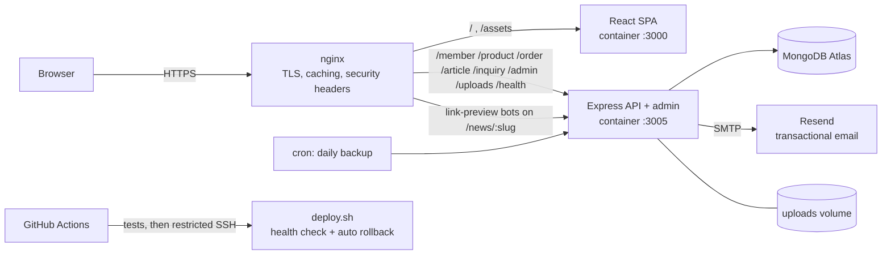

# BookOn — online bookstore (API + admin panel)

[](https://github.com/Jony0998/bookOn/actions/workflows/ci.yml)

Live: **https://bookon.sale** · Frontend repo: [bookon-react1](https://github.com/Jony0998/bookon-react1)

BookOn is a single-store online bookshop for readers in Uzbekistan and abroad (UZ / RU / EN).
This repository holds the **REST API**, the **server-rendered admin panel** the library uses
to run the shop, and the **deployment and operations** setup.

## What it does

| Area | Highlights |
|---|---|
| Catalog | Books with author, language, genre, mood shelves, discounts, stock; likes and views |
| Accounts | Email sign-up and login, email verification, password reset (hashed, single-use, expiring tokens), JWT in an httpOnly cookie |
| Orders | Checkout with delivery details; library-controlled lifecycle *pending → on the way → delivered / cancelled*; stock is taken on confirm and returned on cancel |
| News | Articles with covers, tags and attached books; link previews (Open Graph) for Telegram and other bots |
| Reception | Readers (and guests) ask the library questions; threaded conversation, email notification of replies, private links for guests (HMAC, nothing secret stored), spam limits |
| Admin panel | Dashboard, orders, books, news editor, inbox, readers — EJS, in Uzbek, light/dark |

## Architecture



Both containers listen on `127.0.0.1` only; the internet reaches them through nginx.

## Tech stack

- **Node.js 20, Express 4, TypeScript**, Mongoose 6 (MongoDB Atlas)
- **EJS** + Bootstrap 5 for the admin panel, express-session with a MongoDB store
- **nodemailer** over SMTP (Resend), **multer** uploads, **socket.io**
- **helmet** (CSP and security headers), **express-rate-limit**
- **Docker Compose**, **nginx**, Let's Encrypt, **GitHub Actions**

## Quality and operations

- **End-to-end tests** (`scripts/e2e`, ~186 checks): auth, admin books, orders and stock, news,
  reception, admin login, security. Each suite starts the real server against a `*_test`
  database and refuses to run against anything else.
- **CI** on every push: type-check, build, seed a fresh MongoDB, run every suite.
- **CD** on `master`: after CI passes, a deploy key that can run *only* `scripts/server/ci-deploy.sh`
  deploys over SSH (pinned host key). `deploy.sh` waits for `/health` and **rolls back automatically**
  if the new version isn't healthy.
- **Security**: CSP and security headers, login / sign-up rate limits, body size limits, bcrypt,
  hashed and expiring email tokens, uniform login errors (no account enumeration), files served
  with `nosniff`, asset URLs with content hashes.
- **Health**: `GET /health` → `{ status, db, version, uptimeSeconds }` (503 when the database is down).
- **Backups**: daily `scripts/server/daily-backup.sh` (database as Extended JSON + uploads, 14 days kept,
  checks the library account still exists); restore with `scripts/restore-db.js`.

## Run locally

```bash
npm ci
cp .env.example .env      # MONGO_URL, SESSION_SECRET, SECRET_TOKEN (see below)
npm run start:dev         # API + admin on http://localhost:3003
```

| Variable | Purpose |
|---|---|
| `MONGO_URL` | MongoDB connection string |
| `SESSION_SECRET`, `SECRET_TOKEN` | admin session and JWT secrets |
| `PUBLIC_URL` | site origin used in email links |
| `RESEND_API_KEY` or `SMTP_*`, `MAIL_FROM` | email; `MAIL_DISABLED=1` turns sending off |
| `FRONTEND_URL` | allowed CORS origins (comma separated) |
| `AUTH_RATE_LIMIT`, `ACCOUNT_RATE_LIMIT`, `API_RATE_LIMIT` | optional limit overrides |

## Tests

```bash
# always a *_test database — the scripts refuse any other
export MONGO_URL="mongodb://localhost:27017/BookOn_test"
node scripts/e2e/seed.js   # minimal data for an empty database
npm run test:e2e
```

## Project layout

```
src/
  app.ts, server.ts         Express app, security, error handling, startup
  router.ts                 public JSON API
  router-admin.ts           admin panel (EJS)
  controllers/  models/     request handling / business logic (services)
  schema/                   Mongoose models
  libs/                     security, validation, mailer, types
  views/  public/           admin templates and assets
scripts/
  e2e/                      end-to-end suites + harness + seed
  server/                   daily backup, restricted CI deploy entry
  migrations/  backup-db.js  restore-db.js  smoke-test.js
nginx/bookon.sale.conf      production nginx config (mirrored on the server)
```
